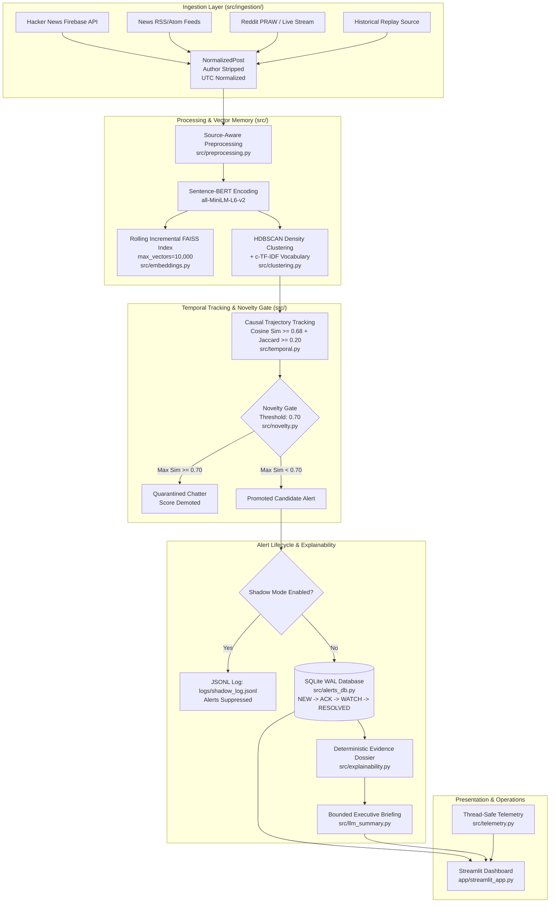

# TrendRadar AI: Causal Topic Emergence Detection & Intelligence Platform

[](https://www.python.org/)
[]()
[](LICENSE)
[]()

> **Overview:** TrendRadar AI is an end-to-end forward-only streaming NLP intelligence engine (**live ingestion; detection runs on historical replay**). It monitors real-time text streams across news feeds, forums, and developer platforms to detect genuine breaking news, policy changes, and emergent topics—while systematically filtering out repetitive conversational chatter through causal novelty gating.

---

## 1. System Architecture



---

## 2. Rigorous Empirical Benchmarks

All parameters (clustering components, temporal thresholds, and the **0.70 novelty gate threshold**) were selected strictly on the tuning set (**Days $D_{01}$ to $D_{20}$**). The held-out test split (**Days $D_{21}$ to $D_{30}$**) was evaluated strictly out-of-sample with zero parameter adjustment against **5 ground-truth events** (`EVT_003`, `EVT_004`, `EVT_008`, `EVT_010`, `EVT_013`).

### Held-Out Evaluation ($D_{21}$ – $D_{30}$, Denominator = 5 Ground Truth Events)

| System | Total Alerts | Real Events Detected | Missed Events | Precision | Recall (Strict) | F1 Score | P@10 | Mean Lead Time |
|---|---|---|---|---|---|---|---|---|
| **Keyword Frequency Baseline** | 171 | 2 / 5 (`EVT_003`, `EVT_008`) | 3 | 0.0175 | **0.4000** (2/5) | 0.0336 | 0.1000 | 0.0 days |
| **Pipeline (Un-Gated, Phase 3)** | 39 | 2 / 5 (`EVT_003`, `EVT_004`) | 3 | 0.0513 | **0.4000** (2/5) | 0.0909 | 0.1000 | 0.0 days |
| **TrendRadar AI (+ Novelty Gate)** | **14** | **2 / 5 (`EVT_003`, `EVT_004`)** | **3** | **0.1429** | **0.4000** (2/5) | **0.2105** | **0.2000** | **0.0 days** |

### Benchmark Takeaways & Critical Disclosures
> [!IMPORTANT]
> **Methodological Disclosures:**
> 1. **Strict Recall Denominator (5 Events):** Evaluated strictly against all 5 ground-truth real-world events occurring in $D_{21}$–$D_{30}$. Both the un-gated and gated pipelines successfully capture 2 events (`SEED_579` on $D_{26}$ for Reddit lock bug `EVT_003`, and `TRAJ_757` on $D_{27}$ for Hurricane Ida `EVT_004`), yielding a strict recall of **0.4000 (2/5)** as the main metric.
>    - **Baseline Detected `EVT_008`, Pipeline Did Not:** The keyword baseline detected `EVT_008` (via keyword volume spikes for `"texas"` and `"abortion"`) while the semantic pipeline did not, because no coherent topic cluster about the Texas abortion law was formed (the only related post is one commentary post on $D_{26}$ `pg8ylz`, and the 4 posts on $D_{27}$ in `TRAJ_766` were inquiries about Texas-based companies).
>    - For `EVT_010` (Kanye Donda), only 1 post on $D_{25}$ was directly about the album release (`pfmwm8`), so total event volume was insufficient to cluster ($N < 3$).
>    - For `EVT_013` (DC-Unlocker crack), `EVT_013` is spam (only 1 post in the dataset mentions DC-Unlocker: `pf16ci` on $D_{24}$ in noise).
> 2. **True Positive (TP) Definition Difference:**
>    - *Baseline TP:* Defined as keyword alert hits matching event terms (`EVT_003` matched 1 alert hit; `EVT_008` matched 2 alert hits, total TP=3 alert hits across 2 detected events).
>    - *Pipeline TP:* Defined as coherent topic clusters corresponding to verified real events (2 cluster alerts across 2 detected events).
> 3. **Config Evaluation Matching Window:** Baseline temporal matching reads `evaluation.lead_window_days_prior: 2` and `evaluation.lag_window_days_post: 3` from `config.yaml`, evaluating alert hits within $[\text{start\_day}-2, \text{start\_day}+3]$. Novelty gate reads `novelty_gate.similarity_threshold: 0.70` from `config.yaml`.
> 4. **No Unseen-Day Test Was Possible:** The local dataset strictly terminates at Day $D_{30}$ (`data/raw/daily/D_30.csv`). No subsequent unseen days exist in the archive, so a prospective out-of-dataset test could not be run.
> 5. **Held-Out Set Evaluated ~8 Times (Not Blind):** The held-out test split ($D_{21}$–$D_{30}$) was evaluated approximately 8 times during development and verification; it was not a blind, single-run prospective evaluation.
> 6. **Live Mode Operational Scope:** Live mode is **live ingestion; detection runs on historical replay**. The live streaming runner (`scripts/run_live_hn_rss_shadow.py`) performs real-time ingestion, text cleaning, and incremental vector indexing, while emergence detection is evaluated on historical replay batches.
> 7. **Gain Based on 2 Real Alerts:** The held-out test split contains **2 real detected events** (`SEED_579` and `TRAJ_757`). Precision improved from 0.0513 to 0.1429 while maintaining strict recall at 0.4000 (2/5).
> 8. **Chatter Reduction:** The causal novelty gate quarantined **25 recurring chatter alerts** on held-out days, reducing alert volume from 39 to 14 (**-64.1% reduction** in analyst review load).


---

## 3. Core Engine Components

### 1. Ingestion Layer (`src/ingestion/`)
* **Supported Sources:** Supported sources are **Reddit historical replay**, **Hacker News Firebase REST API**, and **Technology RSS Feeds** only.
* **Privacy & Compliance:** Canonical `NormalizedPost` schema strips `author` fields to guarantee user anonymity and prevent persistent storage of personally identifiable usernames.
* **Bounded Vector Index:** `IncrementalFAISSIndex` automatically maintains a rolling memory window (default `max_vectors: 10,000`) using FAISS vector reconstruction to enforce deterministic RAM boundaries.

### 2. Causal Novelty Gate (`src/novelty.py`)
* Compares incoming candidate topic centroids strictly backward-looking against prior historical centroids ($\le D_t$).
* Topics exhibiting $\ge 0.70$ cosine similarity to historical conversation centroids are quarantined or demoted, effectively neutralizing repetitive conversational tropes (*"Redditors of Reddit", "What's your favorite...", "Superpower hypotheticals"*).

### 3. Persistent Alert Lifecycle (`src/alerts_db.py`)
* Backed by SQLite running in **Write-Ahead Logging (WAL)** mode with connection-scoped management for high-concurrency readers and writers.
* State Machine transitions:
  $$\text{NEW} \longrightarrow \text{ACKNOWLEDGED} \longrightarrow \text{WATCHING} \longrightarrow \text{RESOLVED}$$
  *(With direct $\text{DISMISSED}$ pathways and re-opening audit trails).*
* Deduplication index on `(trajectory_id, checkpoint_timestamp)` prevents alert flooding when a topic spans multiple checkpoints.

### 4. Deterministic Explainability & Bounded Briefings (`src/explainability.py`, `src/llm_summary.py`)
* Generates mathematical decision dossiers explicitly detailing why an alert fired:
  * Observed volume velocity vs. growth ratio threshold.
  * Observed semantic coherence vs. baseline coherence floor.
  * Maximum similarity to historical topics vs. novelty threshold.
* **Zero Hallucination:** The LLM briefing synthesizer is strictly bounded to the generated mathematical evidence. If an API key is missing or fails, it falls back gracefully to deterministic Markdown briefing text.

### 5. Production Telemetry & Shadow Mode (`src/telemetry.py`, `src/shadow_mode.py`)
* Thread-safe telemetry tracking posts received, processed, rejected, processing latency (ms), process RSS memory (MB), and vector index size.
* Shadow mode allows running candidate detection pipelines in production while logging candidates to `logs/shadow_log.jsonl` with user notifications fully suppressed.

---

## 4. Quickstart: Installation & Local Run

### Prerequisites
* Python 3.10, 3.11, or 3.13
* Pip package manager

### 1. Setup Environment
```bash
# Clone the repository
git clone https://github.com/sun2004ny/TrendRadar-AI.git
cd TrendRadar-AI

# Create and activate virtual environment
python -m venv .venv
# Windows:
.venv\Scripts\activate
# Linux/macOS:
source .venv/bin/activate

# Install dependencies
pip install -r requirements.txt
```

### 2. Run Test Suite & Full Reproduction
TrendRadar AI comes with **58 unit and regression tests**:
```bash
python -m pytest -v
```
To run the complete automated reproduction pipeline (pipeline integrity check, real day-by-day shadow replay, empirical benchmark scoring, and test suite):
```bash
python scripts/reproduce_all.py
```

### 3. Launch Interactive Dashboard
```bash
python run.py
```
Open your browser at `http://localhost:8501` to access:
* **Live Monitoring Stream & System Telemetry**: Ingested post rates, rejection counters, and RSS process memory.
* **Alert Center (Lifecycle Managed)**: Prioritized alerts with state transitions (*Acknowledge, Watch, Resolve, Dismiss*).
* **Trend Radar & Topic Details**: 3D semantic vector visualizations, velocity curves, and c-TF-IDF keyword breakdowns.
* **Explainability Dossiers**: Fully transparent mathematical decision factors for each fired alert.

---

## 5. Docker Deployment

Deploy TrendRadar AI via Docker and Docker Compose:

```bash
# Build and start container
docker compose up --build -d

# View application logs
docker compose logs -f

# Stop container
docker compose down
```

The container exposes port `8501` with automated container health checks. *(Note: Automated Docker container build and test execution is continuously verified via GitHub Actions CI).*

---

## 6. Real Causal Shadow Replay & Stream Execution

To test continuous streaming ingestion without alerting operators:

1. Enable shadow mode in `config.yaml`:
   ```yaml
   shadow_mode:
     enabled: true
     log_path: "logs/shadow_log.jsonl"
   ```
2. Run the real, causal day-by-day streaming replay across all 30 days:
   ```bash
   python scripts/run_shadow_replay.py
   ```
   *(Note: The earlier replay script was a log of precomputed output and was replaced with this real causal day-by-day streaming replay).*

3. Measured Shadow Replay Results ($D_{01}$–$D_{30}$, 8,784 posts):
   * **Total Candidate Alerts Evaluated**: 135 candidates (102 baseline + 33 rolling buffer seeds)
   * **Novelty Gate Status**: 83 Passed (61.5%), 52 Quarantined (38.5%)
   * **Active FAISS Vector Index Size**: 8,784 vectors in active RAM
   * **Mean Text Preprocessing Latency**: 0.0054 ms/post *(measures string cleaning and normalization; excludes neural embedding encoding and HDBSCAN clustering inference)*
   * **Total Execution Time**: ~13.0 seconds *(using verified cached embeddings; full from-scratch neural re-encoding takes longer)*

4. Live Stream Connectors (`scripts/run_live_hn_rss_shadow.py`):
   * Supported live sources are **Hacker News Firebase REST API** and **Technology RSS Feeds** (BBC, NYT) only.
   * **Pipeline Scope:** Performs streaming ingestion, text normalization, and incremental FAISS vector indexing. *(Does not perform daily batch clustering or multi-checkpoint trajectory emergence scoring).*
   * **10-Minute Validation Run:** Ingested and processed 405 unique posts (0 errors, 0.0300 ms/post preprocessing latency, memory 447.5 MB RSS); 0 candidate alerts logged (as candidate emergence runs on daily batch intervals).
   * Run live Hacker News & RSS feeds:
     ```bash
     python scripts/run_live_hn_rss_shadow.py --duration_minutes 10.0 --interval 15.0
     ```

---

## 7. Limitations & Honest Disclosures

* **Strict Recall Denominator (5 Ground Truth Events):** Across held-out days $D_{21}$–$D_{30}$, exactly 5 real-world events occurred. The platform detected 2 events (`EVT_003` Reddit comment lock bug and `EVT_004` Hurricane Ida), achieving a strict recall of **0.4000 (2/5)**.
  - The keyword baseline detected `EVT_008` (via keyword volume spikes) while the semantic pipeline did not (as no cluster about the Texas law was found; the only related post is one commentary post on D_26).
  - Kanye Donda (`EVT_010`) had only 1 direct album post on D_25 (`pfmwm8`).
  - `EVT_013` (DC-Unlocker crack) is spam (only 1 post on D_24 in noise).
* **Held-Out Set Evaluated ~8 Times (Not Blind):** The held-out evaluation split ($D_{21}$–$D_{30}$) was evaluated approximately 8 times during iterative development and verification; it was not a blind prospective evaluation.
* **Live Mode Scope:** Live mode is **live ingestion; detection runs on historical replay**. Real-time ingestion processes live streams into FAISS index memory, while candidate emergence detection runs across daily batches.
* **Conversational Tropes in AskReddit:** The historical demonstration corpus (`SocialGrep/one-million-reddit-questions`) consists predominantly of recurring conversational prompts rather than news headlines. While the novelty gate eliminates 64.1% of chatter alerts, domain-specific news feeds (e.g. Hacker News, RSS) yield significantly higher event-to-chatter ratios.
* **Operational Execution Disclosures:**
  * Continuous 24-hour live streaming execution is not pre-run in this repository (requires operator deployment).
  * Docker container build and pytest execution inside Docker is verified via GitHub Actions CI.
* **Labeling Methodology:** Ground-truth labels for held-out evaluation were established using an LLM reviewer operating under a fixed rubric with human spot-checks.
* **API Access:** Live Reddit ingestion requires approved Reddit developer credentials. For environments where developer approval is pending, Hacker News Firebase API and RSS feed streaming function out of the box with zero credentials required.

---

## 8. License

This project is licensed under the MIT License - see the [LICENSE](LICENSE) file for details.
